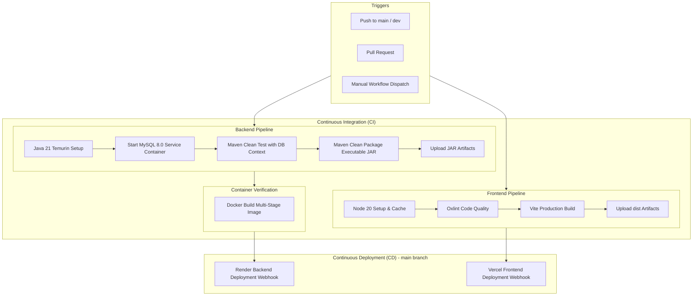
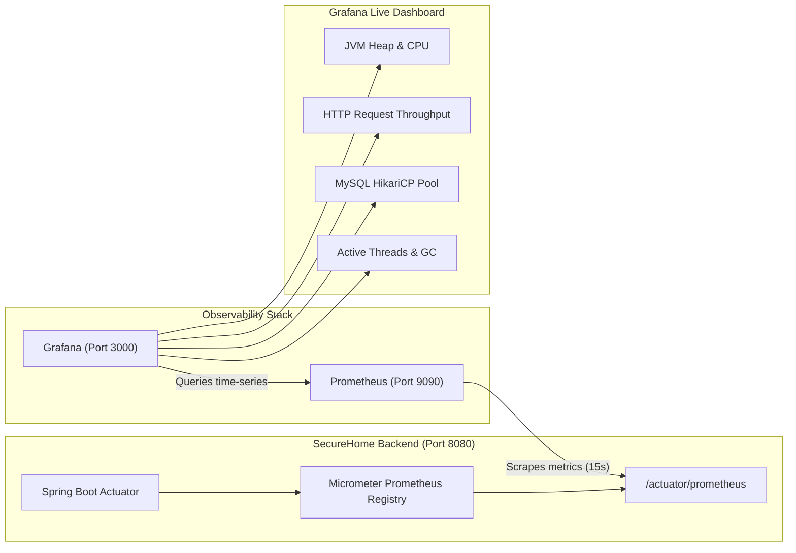
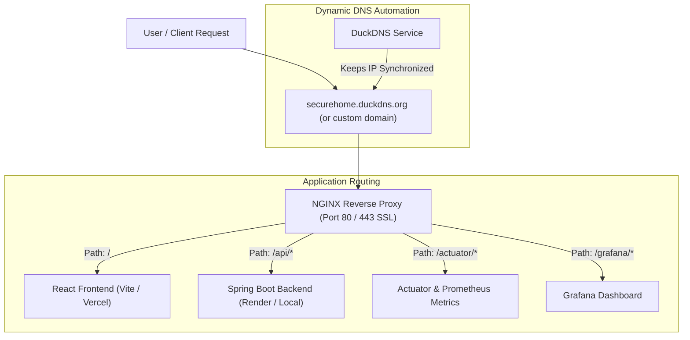

# SecureHome – Smart Security System

[](https://github.com/Harshitharoyal-20/SecureHome/actions)
[](.gitlab-ci.yml)
[](https://secure-home-kappa.vercel.app/)
[](https://render.com/)

## 1. Project Description

SecureHome is a context-aware private room protection and smart locker security system designed to protect valuable items such as jewellery, documents, and electronic devices.

The system provides secure user authentication, role-based access control, locker management, access history tracking, and security alert management. Administrators can manage secure assets and grant permissions to authorized users. Family members and other authorized users can view only the assets they are permitted to access.

The application uses a React frontend, a Spring Boot backend, and a MySQL database to manage users, secure assets, permissions, and security events.

### Key Features
- GitHub OAuth authentication.
- Role-based access control for administrators and regular users.
- Secure locker and asset management.
- Permission-based access to lockers.
- Access history tracking.
- Security alerts restricted to authorized administrators.
- Web-based dashboard for monitoring secure assets.

## 2. Technology Stack

| Component | Technology |
|---|---|
| Frontend | React.js, JavaScript, CSS |
| Frontend build tool | Vite |
| Backend | Java 21, Spring Boot |
| Security | Spring Security, GitHub OAuth 2.0 |
| Database | MySQL 8 |
| Database integration | Spring Data JPA, Hibernate, JDBC |
| Build tool | Maven |
| CI/CD Pipelines | GitHub Actions, GitLab CI/CD |
| Containerization | Docker (Multi-stage build) |
| Monitoring & Metrics | Prometheus, Grafana, Spring Boot Actuator, Micrometer |
| Custom Domain & DDNS | DuckDNS, NGINX Reverse Proxy, Cloudflare |
| Version control | Git and GitHub |
| Frontend deployment | Vercel |
| Backend deployment | Render |
| Database hosting | Aiven MySQL |

## 3. Installation Steps

### Prerequisites

Install the following software:

- Java Development Kit (JDK) 21.
- Node.js and npm.
- Git.
- MySQL database or an accessible Aiven MySQL instance.
- Visual Studio Code or another code editor.

### Step 1: Clone the Repository

Open a terminal and execute:

```bash
git clone https://github.com/Harshitharoyal-20/SecureHome.git
cd SecureHome
```

### Step 2: Configure the Database

Create or configure the MySQL database named `home_security`.

Configure the following environment variables for the backend using your database connection details:

```text
DB_URL=jdbc:mysql://HOST:PORT/home_security
DB_USERNAME=YOUR_DATABASE_USERNAME
DB_PASSWORD=YOUR_DATABASE_PASSWORD
```

Replace the example values with your actual database details. For a hosted database, use the connection information provided by your database provider.

### Step 3: Configure GitHub OAuth

Create or configure a GitHub OAuth application with the callback URL matching the backend's configured OAuth login callback.

Set the following environment variables:

```text
GITHUB_CLIENT_ID=YOUR_GITHUB_CLIENT_ID
GITHUB_CLIENT_SECRET=YOUR_GITHUB_CLIENT_SECRET
```

Keep credentials private. Do not commit database passwords or OAuth client secrets to GitHub.

### Step 4: Install Backend Dependencies

Open a terminal in the backend directory:

```bash
cd home-security
```

On Windows, build the backend using:

```powershell
.\mvnw.cmd clean package -DskipTests
```

On Linux or macOS, use:

```bash
./mvnw clean package -DskipTests
```

The command builds the application without running the tests. Ensure the database and environment variables are configured before running database-dependent tests.

### Step 5: Install Frontend Dependencies

Open another terminal in the repository root and run:

```bash
cd home-security-frontend
npm install
```

## 4. Execution Steps

### Step 1: Start the Backend

Navigate to the backend directory and run the Spring Boot application.

On Windows:

```powershell
.\mvnw.cmd spring-boot:run
```

On Linux or macOS:

```bash
./mvnw spring-boot:run
```

The backend runs on port `8080` by default, unless another port is configured.

Backend URL:

```text
http://localhost:8080
```

### Step 2: Start the Frontend

Open a separate terminal in the frontend directory:

```bash
cd home-security-frontend
npm run dev
```

Vite displays the local frontend URL in the terminal. Open that URL in your browser; it is usually:

```text
http://localhost:5173
```

Configure the frontend's API base URL, if required by the project, to point to the running backend.

### Step 3: Use the Application

1. Open the frontend in your browser.
2. Sign in using the configured GitHub authentication.
3. View the security dashboard.
4. Open **My Lockers** to view accessible secure assets.
5. Open **Access History** to review available access records.
6. Administrators can manage assets, grant permissions, and access security alerts according to their assigned privileges.

## 5. Deployment

The project can be deployed using the following services:

- **Frontend:** Vercel.
- **Backend:** Render.
- **Database:** Aiven MySQL.

Configure the required environment variables in the deployment settings. Ensure the frontend points to the deployed backend, the backend can connect to the database, and the GitHub OAuth callback matches the deployed backend URL.

## 6. CI/CD Pipelines

SecureHome employs enterprise-grade continuous integration and continuous deployment pipelines using both **GitHub Actions** and **GitLab CI/CD** to ensure automated testing, static analysis, artifact generation, containerization, and automated production deployment.

### Pipeline Architecture Overview



---

### 1. GitHub Actions (`.github/workflows/ci-cd.yml`)

The GitHub Actions workflow triggers on push/pull requests to `main` and `dev` branches, as well as manual triggers (`workflow_dispatch`).

#### Pipeline Jobs:
1. **Frontend CI (`frontend-ci`):**
   - Configures Node.js 20 with `npm` dependency caching.
   - Executes `npm ci` for deterministic dependency resolution.
   - Runs static code linting via `oxlint`.
   - Compiles and builds production assets with Vite (`npm run build`).
   - Archives the production bundle (`dist/`) as a downloadable workflow artifact.

2. **Backend CI (`backend-ci`):**
   - Spins up a dedicated **MySQL 8.0 service container** with automated health checks (`mysqladmin ping`).
   - Configures Temurin JDK 21 with Maven dependency caching.
   - Executes Spring Boot automated tests (`./mvnw clean test`) against the live MySQL container.
   - Packages the executable Spring Boot JAR (`./mvnw package -DskipTests`).
   - Archives the backend JAR (`target/*.jar`) as a workflow artifact.

3. **Docker Verification (`docker-verify`):**
   - Builds the backend container image using the multi-stage [Dockerfile](file:///c:/Users/harsh/Downloads/DBMS123/home-security/Dockerfile) to guarantee container readiness.

4. **Continuous Deployment (`deploy-backend` & `deploy-frontend`):**
   - Triggers automated deployment on pushes to `main`.
   - Employs Render deploy webhooks (`RENDER_DEPLOY_HOOK_URL`) for the backend.
   - Employs Vercel deploy webhooks (`VERCEL_DEPLOY_HOOK_URL`) for the frontend.

---

### 2. GitLab CI/CD (`.gitlab-ci.yml`)

The GitLab CI/CD configuration defines a 5-stage pipeline for multi-environment validation:

| Stage | Job | Purpose | Environment / Image |
|---|---|---|---|
| `lint` | `frontend:lint` | Static code analysis via oxlint | `node:20-alpine` |
| `test` | `backend:test` | Spring Boot context & unit tests | `eclipse-temurin:21` + `mysql:8.0` service |
| `build` | `frontend:build` | Compiles Vite production bundle | `node:20-alpine` (Artifact: `dist/`) |
| `build` | `backend:build` | Packages executable Spring Boot JAR | `eclipse-temurin:21` (Artifact: `target/*.jar`) |
| `package` | `backend:docker-verify` | Validates container build via Docker-in-Docker | `docker:27` + `docker:27-dind` |
| `deploy` | `deploy:backend-render` | Triggers Render production redeploy | `curlimages/curl:latest` |
| `deploy` | `deploy:frontend-vercel` | Triggers Vercel production redeploy | `curlimages/curl:latest` |

---

### 3. Pipeline Secrets & Configuration

To enable automated production deployments, configure the following secrets/variables in your repository settings:

| Secret / Variable Name | Platform | Description |
|---|---|---|
| `RENDER_DEPLOY_HOOK_URL` | GitHub / GitLab | Webhook URL from Render Dashboard to trigger automatic backend redeploys |
| `VERCEL_DEPLOY_HOOK_URL` | GitHub / GitLab | Webhook URL from Vercel Project Settings (Git > Deploy Hooks) |

> [!NOTE]
> If deployment hook secrets are not set, the CI stages (lint, test, build, docker-verify) will run and succeed, gracefully skipping the deploy step with an informative log message.

#### Setting Secrets in GitHub:
1. Go to repository **Settings** > **Secrets and variables** > **Actions**.
2. Click **New repository secret**.
3. Add `RENDER_DEPLOY_HOOK_URL` and `VERCEL_DEPLOY_HOOK_URL`.

#### Setting Variables in GitLab:
1. Go to repository **Settings** > **CI/CD** > **Variables**.
2. Click **Add variable** (check *Mask variable* for sensitive tokens).

---

---

## 7. Application Monitoring & Observability (Prometheus & Grafana)

SecureHome incorporates an enterprise-grade monitoring and observability stack combining **Spring Boot Actuator**, **Micrometer**, **Prometheus**, and **Grafana** to provide real-time visibility into application performance, JVM health, HTTP request throughput, and database connection pooling.



### Metrics Exposed by the Application:
- **JVM Health:** Heap/Non-heap memory allocation (`jvm_memory_used_bytes`, `jvm_memory_max_bytes`), Garbage Collection pauses, and thread states (`jvm_threads_live_threads`).
- **CPU & System:** JVM process CPU usage (`process_cpu_usage`), system-wide CPU load (`system_cpu_usage`), and uptime (`process_uptime_seconds`).
- **HTTP Server Metrics:** Throughput, request rates, status codes (2xx, 4xx, 5xx), and p95 latency broken down by URI endpoints (`http_server_requests_seconds_count`, `http_server_requests_seconds_max`).
- **MySQL Database Pool:** HikariCP connection pool health (`hikaricp_connections_active`, `hikaricp_connections_idle`, `hikaricp_connections_pending`).

### Running the Monitoring Stack Locally:

The entire monitoring environment is containerized with auto-provisioned Prometheus datasources and dashboards:

```bash
cd monitoring
docker compose up -d
```

Access the monitoring interfaces:
* **Grafana Dashboard:** http://localhost:3000 (Default login: `admin` / `admin`)
  - Auto-loads the **SecureHome – Application & System Monitoring** dashboard.
* **Prometheus Targets & Query UI:** http://localhost:9090

---

## 8. Custom Domain & Dynamic DNS (DuckDNS & NGINX)

To provide stable domain resolution and secure HTTPS access across cloud, VPS, or homelab deployments, SecureHome supports **DuckDNS** (free Dynamic DNS), custom domain mappings, and **NGINX Reverse Proxy** with SSL/TLS termination.



### 1. DuckDNS Setup:
DuckDNS provides a free, perpetual subdomain (e.g. `https://securehome.duckdns.org`) pointing dynamically to your public IP.
1. Sign in to [DuckDNS](https://www.duckdns.org) using GitHub or Google.
2. Create your custom subdomain (e.g. `securehome`).
3. Note your private **Token**.
4. Run the automated updater using either:
   - **Docker Container:** Included in `monitoring/docker-compose.yml` (configure `DUCKDNS_SUBDOMAINS` and `DUCKDNS_TOKEN` in `monitoring/duckdns/.env`).
   - **Shell Script:** Execute `monitoring/duckdns/duckdns-updater.sh` on any Linux/macOS host or cron job.

### 2. NGINX Reverse Proxy Configuration:
The configuration in [monitoring/nginx/nginx.conf](file:///c:/Users/harsh/Downloads/DBMS123/monitoring/nginx/nginx.conf) routes requests under a unified domain:
- `https://securehome.duckdns.org/` -> Forwards to React frontend.
- `https://securehome.duckdns.org/api/` -> Forwards to Spring Boot API.
- `https://securehome.duckdns.org/actuator/` -> Exposes health & Prometheus metrics.
- Enforces HTTP to HTTPS redirection and modern TLS 1.2/1.3 encryption.

### 3. Custom Domain on Render & Vercel:
* **Frontend (Vercel):** Go to Project Settings > **Domains** > Add your custom domain (or CNAME record pointing `cname.vercel-dns.com`).
* **Backend (Render):** Go to Web Service Settings > **Custom Domains** > Add your custom domain (e.g. `api.securehome.duckdns.org`) with the provided CNAME target.

---

## 9. Repository Structure

```text
SecureHome/
├── .github/
│   └── workflows/
│       └── ci-cd.yml          # GitHub Actions CI/CD Pipeline
├── .gitlab-ci.yml             # GitLab CI/CD Multi-Stage Pipeline
├── monitoring/                # Production Monitoring & Domain Stack
│   ├── docker-compose.yml     # Prometheus + Grafana + DuckDNS containers
│   ├── prometheus/
│   │   └── prometheus.yml     # Prometheus scrape configuration
│   ├── grafana/
│   │   ├── provisioning/      # Automated datasource & dashboard loading
│   │   └── dashboards/        # SecureHome pre-configured monitoring dashboard
│   ├── duckdns/               # DuckDNS DDNS updater scripts & config
│   └── nginx/
│       └── nginx.conf         # Reverse proxy with SSL & custom domain routing
├── home-security/             # Spring Boot Backend (Java 21)
│   ├── src/
│   │   ├── main/              # REST APIs, SecurityConfig, Actuator
│   │   └── test/              # Integration Tests & Test Properties
│   ├── Dockerfile             # Multi-stage Docker packaging
│   ├── pom.xml                # Maven project definition (Actuator + Prometheus)
│   └── mvnw                   # Maven wrapper
└── home-security-frontend/    # React Frontend
    ├── src/
    ├── public/
    ├── package.json           # Dependencies, lint, build scripts
    ├── vite.config.js         # Vite bundler configuration
    └── .oxlintrc.json         # Static analysis rules
```

The backend directory contains the Spring Boot application, while the frontend directory contains the React application.

## 10. Conclusion

SecureHome provides an enterprise-ready smart security system combining robust authentication, role-based authorization, smart locker management, automated CI/CD pipelines (GitHub Actions & GitLab CI/CD), full-stack monitoring (Prometheus & Grafana), and custom domain routing (DuckDNS & NGINX).

**GitHub Repository:** https://github.com/Harshitharoyal-20/SecureHome

**Live Application:** https://secure-home-kappa.vercel.app/


